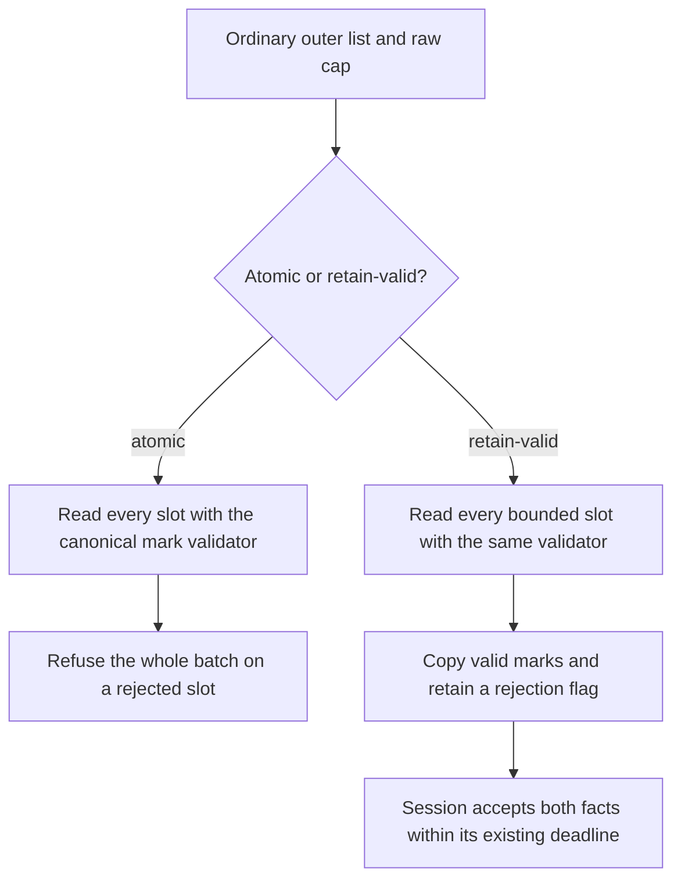

# Attention mark admission

`contract.ts` holds the fixed mark/reference ceilings and caller policy.
`ordinary.ts` admits ordinary outer lists before slot payloads; `readMark.ts`
is the single per-mark schema. The parent facade keeps strict `admitMarks`
for writer, stored evidence, native record scopes and PROV. Only an explicitly
opted-in generic cause query uses its partial projection. Rejected slots are
coverage gaps, never valid claims or invented evidence references.

Both strategies preserve input order, duplicates, copied frozen marks and
caller-specific strict caps. The generic query retains positives and the
rejection flag as one Session value: interrupted/late values are not published.
Adjacent tests cover descriptor order; public boundary cases live beside the
cause query tests. This folder adds no storage, provider or graph authority.

