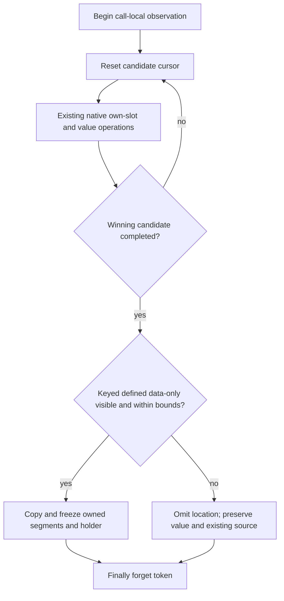

# One native read location

`types.ts` owns the additive `LocatedRead` contract; only that type is public
through `foottrace/write`. `capture.ts` owns bounded scratch for a single active
native read. The existing traversal sends its already-consumed primitive string
selectors. It never revisits caller arrays, decodes history or traverses values.

Only the new cursor resets between snapshot, live namespace and live root
candidates. Existing source `dataOnly`, selected address, live status and
canonical getter/undefined tracking keep their original semantics. Accessor
taint for location survives a losing candidate. Limits are 64 total segments,
1024 UTF-16 units per segment and 4096 total units; overflow omits the whole
location. Literal empty/dot/slash/U+001F/index strings remain literal.

The private weak association is an active-call capability, not a frame's last
read or a retained history bank. The observation sent through existing ports
exposes no mutable cursor. The public method's `finally` removes it on success
and original read/verdict errors; tests ensure completed tokens cannot revive.
Owned location copies survive retirement, reentrancy and caller mutation.

Location establishes a structural native selection, not semantic use, producer
authentication, complete read coverage or privacy history. Host privacy remains
its authority; source-mode nonvisible verdicts omit the location without another
callback. The subsequent engine event-time privacy adapter is separate work.
